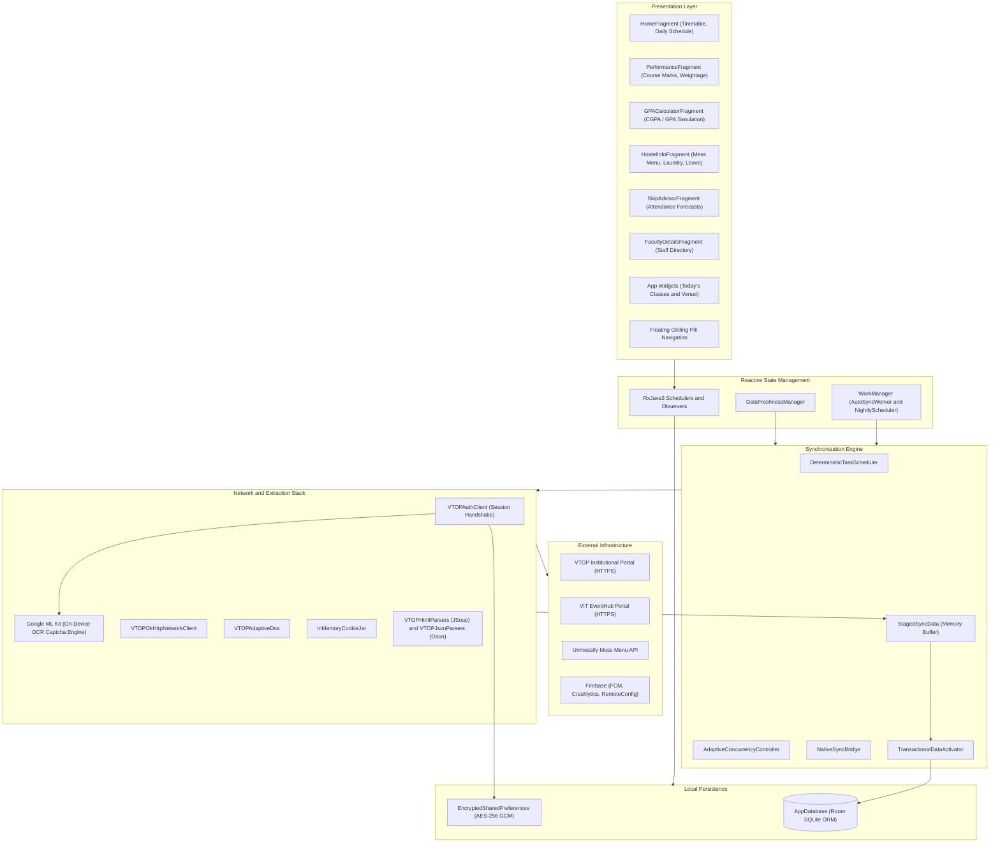
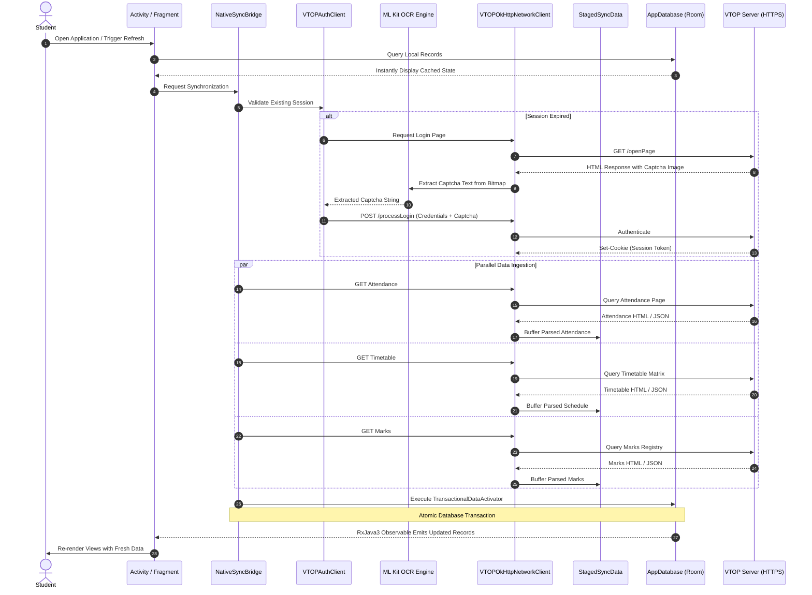

# VIT Sync - Academic Companion for Vellore Institute of Technology

<div align="center">

  

  <h3>Offline-First Academic Dashboard and Student Utility Client</h3>

  <p>
    <a href="https://github.com/aasif-10/StudentCC/releases/latest"></a>
    <a href="https://github.com/aasif-10/StudentCC/actions/workflows/build.yml"></a>
    <a href="LICENSE"></a>
    <a href="https://developer.android.com/about/versions/nougat"></a>
    <a href="https://developer.android.com/about/versions/14"></a>
  </p>

  <p>VIT Sync is an Android client engineered for students of Vellore Institute of Technology. Built with an offline-first architecture, on-device machine learning for portal authentication, and a matte black and white interface, it provides instant access to academic schedules, attendance tracking, marks analytics, and campus services directly on the device.</p>

  <p>
    <a href="https://github.com/aasif-10/StudentCC/releases"><strong>Releases</strong></a>
    &bull;
    <a href="https://github.com/aasif-10/StudentCC/issues"><strong>Issue Tracker</strong></a>
    &bull;
    <a href="https://github.com/aasif-10/StudentCC/discussions"><strong>Discussions</strong></a>
  </p>

</div>

---

## Table of Contents

- [System Architecture](#system-architecture)
- [Key Features](#key-features)
- [Key Design Decisions](#key-design-decisions)
- [Data Flow and Synchronization](#data-flow-and-synchronization)
- [Technology Stack](#technology-stack)
- [Project Directory Structure](#project-directory-structure)
- [Building and Running Locally](#building-and-running-locally)
- [CI/CD Pipeline](#cicd-pipeline)
- [Security and Privacy Architecture](#security-and-privacy-architecture)
- [Contributing](#contributing)
- [Partnerships and Credits](#partnerships-and-credits)
- [License](#license)

---

## System Architecture

VIT Sync employs an offline-first layered architecture. All network operations are executed directly between the Android client and the official institutional portal (VTOP) over HTTPS without proxy servers or intermediary cloud databases. Academic data is stored locally in an embedded database and exposed to the user interface via reactive streams.



---

## Key Features

### Timetable and Home Screen Widget
- Daily schedule view displaying subject name, course code, venue, and faculty details.
- Navigation bar for day-by-day timetable browsing (Monday through Sunday).
- 4x3 interactive launcher widget (Today's Classes & Venue) displaying real-time class details and venue locations directly on the home screen.
- Deep-linking from widget rows to in-app course details with Android 12+ (API 31+) mutable pending intents.

### Attendance Tracking and Skip Advisor
- Percentage tracking per course and overall cumulative attendance.
- On Duty (OD) session tracking with combined statistics.
- Interactive attendance heatmap view displaying attendance frequency and distribution across academic weeks.
- Smart Skip Advisor:
  - Custom overall attendance target (e.g. 85%) and course minimum threshold (e.g. 75%).
  - Deterministic projection calculation showing overall and course-level attendance percentages after hypothetical skips.
  - Identification of upcoming theory vs. lab sessions and remaining instructional days.

### Marks and Performance Analytics
- Cumulative score analysis per course:
  - Overall Course Score
  - Theory Weightage
  - Lab Weightage
  - Project Weightage
  - Class Average Benchmarking
- Circular progress indicators illustrating scored points relative to component maximums.
- Class average input dialog to compute student performance delta relative to the batch mean.

### GPA and CGPA Tools
- CGPA simulation based on VIT 10-point relative grading scale (S, A, B, C, D, E, F, N).
- GPA Predictor to estimate required grade point averages in future courses to hit target cumulative goals.
- All-semesters historical performance viewer with credit breakdowns.

### Hostel, Mess Menu, and Laundry
- Mess Menu: Real-time menu browsing across Special, Non-Veg, and Veg allocations for Breakfast, Lunch, Snacks, and Dinner via Unmessify integration.
- Mess Expense Tracker: ML Kit optical text recognition for scanning mess receipts and logging daily food expenditures against monthly limits.
- Laundry Schedule: Tracking of scheduled laundry collection and delivery days by hostel block and room number.
- Leave Status: Monitoring of submitted hostel leave requests and approval statuses.

### Campus Events and Faculty Directory
- EventHub Integration: Live listing of campus events, club workshops, and conferences scraped from the institutional EventHub portal.
- Filter campus events by category (Free, Upcoming, VITian) and search query.
- Faculty Directory: Offline directory searchable by faculty name, school, designation, and cabin location with favorite bookmarking.

### Google Calendar Synchronization
- Export academic calendar events, instructional schedules, holidays, and examination periods to Android's native Calendar Provider and Google Calendar.

### User Interface Design
- Matte black and white palette designed for contrast and battery efficiency:
  - Canvas background: `#09090B`
  - Card surfaces: `#121215`
  - Border outlines: `#24242A` (1dp stroke)
  - Primary text: `#FFFFFF`
  - Secondary text: `#A1A1AA`
- Floating bottom navigation container with a hardware-accelerated gliding pill indicator translating smoothly behind active destinations.
- Coordinated horizontal slide animations between primary navigation destinations.

---

## Key Design Decisions

### 1. Direct-to-Portal Client-Side Scraping
- Decision: Network requests originate directly from the student device to the official VTOP portal over HTTPS.
- Rationale: Storing or routing student credentials through third-party servers presents security liabilities. Handling the authentication handshake and parsing on the client guarantees that credentials and academic data remain isolated on the user device.

### 2. On-Device Vision AI for Portal Authentication
- Decision: Integrated Google ML Kit on-device Text Recognition (`play-services-mlkit-text-recognition`) to parse portal login captchas locally.
- Rationale: Local inference executes within approximately 40 milliseconds on-device without cloud API dependencies, network hops, or recurring costs.

### 3. Offline-First Reactive Data Architecture
- Decision: View layers do not query remote endpoints directly; they observe Room database queries via RxJava3 streams.
- Rationale: Academic portals often experience downtime or high latency during peak registration and result periods. The local database guarantees zero-millisecond interface load times, while background workers handle network synchronization.

### 4. Transactional Data Staging and Activation
- Decision: Network responses are parsed into an in-memory buffer (`StagedSyncData`) and committed inside a single atomic Room database transaction (`TransactionalDataActivator`).
- Rationale: Prevents database corruption or partial states if network connectivity drops midway through parsing courses, schedules, and marks.

### 5. Encrypted Credential Isolation
- Decision: Utilizes AndroidX Security Crypto's `EncryptedSharedPreferences` with AES-256 GCM encryption backed by the Android KeyStore.
- Rationale: Protects stored session cookies and authentication credentials against unauthorized extraction on rooted devices or via system backup routines.

---

## Data Flow and Synchronization



---

## Technology Stack

### Core Frameworks and Libraries
| Component | Library | Version | Purpose |
|---|---|---|---|
| Architecture | Android Jetpack | API 24 - 34 | Core Android application framework |
| Database | Room Runtime & RxJava3 | 2.6.1 | SQLite object relational mapping and persistence |
| Asynchronous Streams | RxJava3 / RxAndroid | 3.0.0 | Event stream handling and thread management |
| Network Transport | Retrofit 2 / OkHttp 3 | 2.9.0 | HTTP client, cookie persistence, and custom DNS |
| Document Parsing | JSoup | 1.15.4 | Server-side HTML DOM extraction and parsing |
| Data Serialization | Google Gson | 2.10.1 | JSON parsing and object mapping |
| Machine Learning | Google ML Kit Text Recognition | 19.0.0 | On-device text recognition for captcha solving |
| Security | AndroidX Security Crypto | 1.1.0-alpha06 | Hardware-backed AES-256 GCM encrypted storage |
| Background Work | AndroidX WorkManager | 2.9.0 | Periodic and scheduled background sync execution |
| UI Components | Google Material Components | 1.8.0 | Material 3 components, tabs, cards, and inputs |
| Image Caching | Bumptech Glide | 4.16.0 | Profile photo decoding, resizing, and memory caching |
| Markdown Rendering | Markwon Core | 4.6.2 | Text formatting for announcements and update notes |
| Telemetry & Push | Firebase SDK (BoM) | 32.7.0 | Crashlytics, Cloud Messaging, and Remote Config |

---

## Project Directory Structure

```
StudentCC/
├── .github/
│   └── workflows/
│       └── build.yml               # GitHub Actions build and release workflow
├── app/
│   ├── build.gradle                # Application dependencies, SDK targets, and signing configs
│   ├── proguard-rules.pro          # R8 and ProGuard optimization rules
│   ├── studentcc.keystore          # Release signing keystore
│   └── src/
│       ├── main/
│       │   ├── AndroidManifest.xml # Permissions, activities, receivers, and services
│       │   ├── assets/             # Bundled static data (faculty directory index)
│       │   ├── java/com/salmanmalvasi/studentcc/
│       │   │   ├── activities/     # MainActivity, LoginActivity, Analytics, Themes
│       │   │   ├── adapters/       # RecyclerView and ViewPager adapters
│       │   │   ├── animations/     # Custom view resizing and alpha animations
│       │   │   ├── fragments/      # Home, Performance, GPA, Hostel, SkipAdvisor
│       │   │   ├── helpers/        # Database singletons, ThemeManager, Settings
│       │   │   ├── models/         # Room entities and data transfer models
│       │   │   ├── sync/           # Network clients, auth logic, and HTML/JSON parsers
│       │   │   ├── widgets/        # PerformanceCard, TimetableWidget, HeatmapView
│       │   │   └── workers/        # WorkManager background task implementations
│       │   └── res/
│       │       ├── color/          # Theme color selectors for navigation and tabs
│       │       ├── drawable/       # Shape definitions, vector graphics, and backgrounds
│       │       ├── layout/         # Activity and fragment XML layouts
│       │       ├── values/         # Color palettes, string resources, style definitions
│       │       └── values-night/   # Dark mode resources and theme overrides
│       └── test/                   # JUnit 4 unit tests and MockWebServer network tests
├── .env.example                    # Template for Firebase credentials
├── build.gradle                    # Root project build script
├── generate-config.sh              # Script generating google-services.json from environment
├── gradle.properties               # Gradle JVM arguments and AndroidX flags
├── gradlew / gradlew.bat           # Gradle wrapper scripts
├── LICENSE                         # License text (GNU GPL-3.0)
└── README.md                       # Project documentation
```

---

## Building and Running Locally

### Prerequisites
- Java Development Kit (JDK) 17
- Android Studio (Hedgehog 2023.1.1 or newer recommended)
- Android SDK Platform 34 (Installed via Android Studio SDK Manager)
- Git command-line tools

### Step 1: Clone the Repository
```bash
git clone https://github.com/aasif-10/StudentCC.git
cd StudentCC
```

### Step 2: Configure Firebase Environment
The application build utilizes `generate-config.sh` to produce `app/google-services.json`.

1. Copy the environment configuration template:
   ```bash
   cp .env.example .env
   ```
2. If Firebase variables are left empty, the script automatically generates mock configuration parameters sufficient for local compilation and unit tests:
   ```bash
   # On Linux / macOS:
   chmod +x ./generate-config.sh
   ./generate-config.sh

   # On Windows (Git Bash):
   ./generate-config.sh
   ```

### Step 3: Execute Unit Tests
Execute the test suite to verify parsers and business logic:
```bash
# Linux / macOS
./gradlew testDebugUnitTest

# Windows
.\gradlew.bat testDebugUnitTest
```

### Step 4: Assemble Application Packages

- Debug APK:
  ```bash
  # Linux / macOS
  ./gradlew assembleDebug

  # Windows
  .\gradlew.bat assembleDebug
  ```
  Artifact location: `app/build/outputs/apk/debug/app-debug.apk`

- Release APK (Signed):
  ```bash
  # Linux / macOS
  ./gradlew assembleRelease

  # Windows
  .\gradlew.bat assembleRelease
  ```
  Artifact location: `app/build/outputs/apk/release/StudentCC.apk`

### Step 5: Install on Device or Emulator
```bash
# Ensure an active device is connected via ADB
./gradlew installDebug
```

---

## CI/CD Pipeline

The repository integrates a GitHub Actions workflow (`.github/workflows/build.yml`) triggered on pushes to the `main` branch and all pull requests:

```mermaid
flowchart LR
    Trigger["Commit / PR to main"] --> Setup["Checkout & Set up JDK 17 with Gradle Cache"]
    Setup --> Config["Generate google-services.json from Secrets"]
    Config --> Tests["Run Unit Tests (testDebugUnitTest)"]
    Tests --> Assemble["Assemble Minified Release APK (assembleRelease)"]
    Assemble --> Artifacts["Upload StudentCC.apk and about.json Artifacts"]
    Artifacts --> Release["Publish GitHub Release (On Push to main)"]
```



- Build Validation: Runs JDK 17 in Ubuntu environments with automated Gradle dependency caching.
- Automated Test Execution: Executes all unit tests prior to artifact compilation.
- Release Packaging: Generates production APKs with code shrinking, ProGuard optimizations, and release signing.
- Automated Releases: Commits pushed to `main` produce a tagged GitHub release with attached installation binaries and update metadata.

---

## Security and Privacy Architecture

- Zero Intermediary Storage: Academic credentials, marks, and attendance records are never transmitted to external servers. All network transactions connect directly to institutional endpoints via TLS 1.3.
- On-Device Optical Processing: Captcha images are decoded in system memory and processed directly by Google ML Kit without uploading images to cloud APIs.
- Encrypted Local Credentials: Authentication cookies and stored passwords are encrypted using AndroidX Security Crypto with AES-256 GCM backed by the Android KeyStore.
- Disallowed Cleartext Traffic: All unencrypted HTTP network communication is disabled within the application network security configuration.
- Anonymous Telemetry: Firebase Crashlytics reports contain stack traces and system metrics only. Student registration numbers, names, and academic records are excluded from crash logs.

---

## Contributing

Contributions to improve stability, add features, or refine portal parsers are welcome.

1. Fork the repository.
2. Create a topic branch:
   ```bash
   git checkout -b feature/your-feature-name
   ```
3. Commit your changes with descriptive messages:
   ```bash
   git commit -m "fix(sync): handle alternate attendance table layout"
   ```
4. Verify that all unit tests continue to pass:
   ```bash
   ./gradlew testDebugUnitTest
   ```
5. Push your branch to GitHub:
   ```bash
   git push origin feature/your-feature-name
   ```
6. Submit a Pull Request detailing the changes and testing performed.

---

## Partnerships and Credits

- Unmessify: Collaboration with the Unmessify team ([kaffeine.tech/unmessify](https://kaffeine.tech/unmessify)) for mess menu integration.
- VIT Student Community: Acknowledgments to the student body for bug reports, testing, and feedback across portal revisions.

---

## License

This project is licensed under the GNU General Public License v3.0 (GPL-3.0).  
Refer to the [LICENSE](LICENSE) file for the full license text.
